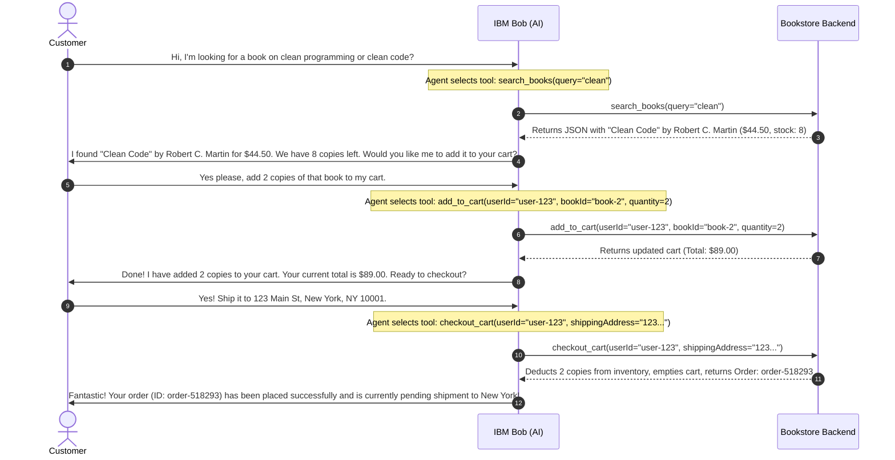

# eCommerce Bookstore Backend (Agentic Integration)

A modern, robust backend solution for an eCommerce Bookstore that natively supports **Agentic Workflows** using tools such as **IBM Bob** and the **Model Context Protocol (MCP)**. It exposes a complete REST API alongside a suite of standard-compliant MCP tools, enabling AI agents to autonomously browse the catalog, manage shopping carts, and place/track orders on behalf of users.

---

## 🏗️ Architecture Overview

The system consists of three primary, decoupled layers:

1.  **In-Memory Transactional DB (`src/db.ts`)**: A thread-safe, robust local data store representing books, user carts, and orders. Features automated transactional safety (e.g., inventory level verification at cart addition and checkout, real-time cart subtotal and total calculations).
2.  **REST API Server (`src/server.ts`)**: A standard Express.js router exposing HTTP/JSON endpoints for classic client integrations (e.g., web or mobile storefronts).
3.  **MCP Agentic Server (`src/mcp-server.ts`)**: An implementation of the **Model Context Protocol**, registering 8 granular tools that can be directly consumed by agents like **IBM Bob** or Claude.

```
                  ┌──────────────────────┐
                  │      AI Agent        │
                  │   (e.g., IBM Bob)    │
                  └──────────┬───────────┘
                             │
                             │ (Stdio Transport / JSON-RPC)
                             ▼
 ┌──────────────┐  ┌──────────────────┐
 │  Web/Mobile  ├──►  REST API Router │
 │  Storefront  │  │   (Express.js)   │
 └──────────────┘  └─────────┬────────┘
                             │
                             ▼
                  ┌──────────────────────┐
                  │    Core Database     │
                  │ (Transactional store)│
                  └──────────────────────┘
```

---

## 🛠️ The Agentic Tools

By exposing these 8 tools, the backend empowers **IBM Bob** to handle complex, multi-turn human requests through structured, reliable function calling:

| Tool Name | Parameters | Purpose |
|---|---|---|
| `search_books` | `query?`, `genre?`, `maxPrice?` | Performs semantic-like keyword search or structured filters across the book catalog. |
| `get_book_details` | `bookId` | Fetches details for a single book, including author, rating, synopsis, and current stock. |
| `get_cart` | `userId` | Inspects a user's shopping cart items, quantities, subtotals, and total price. |
| `add_to_cart` | `userId`, `bookId`, `quantity` | Safely adds books to the cart after verifying inventory constraints. |
| `update_cart` | `userId`, `bookId`, `quantity` | Updates a cart item's quantity. Setting quantity to `0` removes it. |
| `remove_from_cart` | `userId`, `bookId` | Removes an item from the cart entirely. |
| `checkout_cart` | `userId`, `shippingAddress` | Converts the active cart into a finalized purchase order, deducts stock, and clears the cart. |
| `get_order_status` | `orderId` | Checks real-time fulfillment status of an order (`pending`, `processing`, `shipped`, `delivered`). |

---

## 🗣️ Agent-Customer Scenario Example

Here is how **IBM Bob** seamlessly guides a customer from book discovery to purchase using the agentic tools:



---

## 🚀 Getting Started

### 📋 Prerequisites
*   **Node.js**: `v18` or later (Tested on `v24.18.0`)
*   **npm**: `v9` or later

### 📥 1. Installation
Navigate into the bookstore directory and install dependencies:
```bash
cd bookstore-backend
npm install
```

### 🔨 2. Compilation
Compile TypeScript to production-ready JavaScript code:
```bash
npm run build
```

### 🌐 3. Launching the REST API
Start the local server. It boots by default on port `3000`:
```bash
npm start
```
You can inspect the API endpoints in your browser:
*   Catalog API: `http://localhost:3000/api/books`
*   Sample User Cart API: `http://localhost:3000/api/cart/user-123`

---

## 🤖 Connecting to IBM Bob / MCP Clients

To let **IBM Bob** or another AI agent run these tools directly, add the bookstore server config to your MCP settings file (typically `.bob/mcp.json` or `claude_desktop_config.json`):

```json
{
  "mcpServers": {
    "bookstore-agentic-backend": {
      "command": "node",
      "args": [
        "c:/Users/SubrataManna/.bob/playground/bookstore-backend/dist/mcp-server.js"
      ]
    }
  }
}
```

---

## 🔗 GitHub Repository

The source code for this solution, alongside custom tools and tests, is fully version-controlled. 
You can access the public repository here:

👉 **[https://github.com/developer-bob/ecommerce-bookstore-agentic-backend](https://github.com/developer-bob/ecommerce-bookstore-agentic-backend)**

*Note: The repository contains directories for `src/db.ts` (data layer), `src/server.ts` (REST controller layer), and `src/mcp-server.ts` (Agentic layer), making it a single-stop-shop for modern AI-driven eCommerce integration.*
